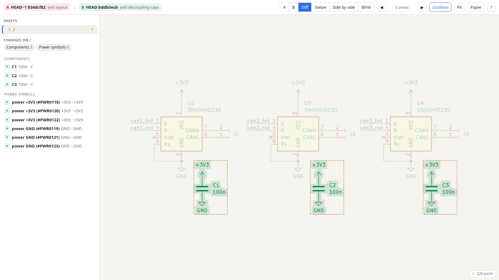
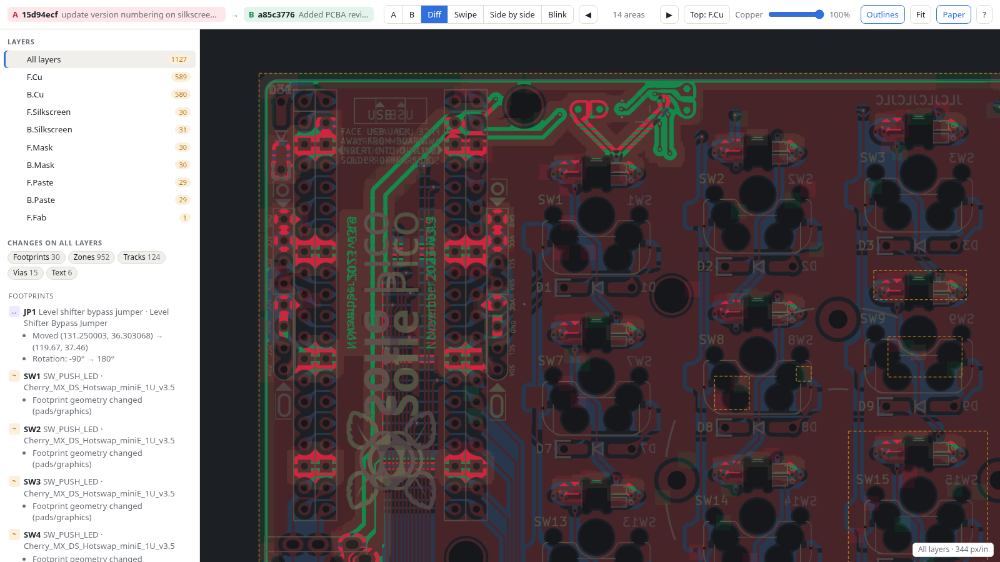

# dreiecKi

Visual diff of KiCad schematics, or PCBs with `-pcb`, between two git revisions. It produces one
self-contained, interactive HTML file.

**[Live demo](https://uberrice.github.io/dreiecki/):** a schematic and a PCB report from a small test project.

```sh
dreiecki HEAD~1                 # last commit vs. working tree
dreiecki main my-branch         # two branches / tags / commits
dreiecki v7..v8 -o review.html --open
dreiecki -s boards/main/main.kicad_sch HEAD~3   # pick the root schematic explicitly
dreiecki -pcb HEAD~1            # the board instead of the schematic
dreiecki -pcb                   # no revisions: just view the current board
```

With no revision, dreiecki renders the working tree on its own, in the same viewer without the
comparison tools. This works outside a git repository too. An explicitly empty revision is an error:
`empty revision: expected a commit, branch or tag`.

Requirements: `git` 2.24 or newer. The viewer works offline in any current browser.

dreiecki renders with `kicad-cli` from KiCad 8 or newer if it finds one. Without it, or with `-builtin`,
it uses its own renderer. That renderer needs nothing else installed, but its output is not identical
to KiCad's: the drawing sheet is always KiCad's default one, pin and label shapes are simplified,
and `-theme` has no effect. Text uses KiCad's Newstroke font, embedded in the binary. Text-box wrapping and
custom-pad mask/paste margins are approximate. The structured change list is independent of the
renderer; unsupported or simplified graphics can hide changes from the visual comparison.

## What you get

* **Sheets list.** Every page of the hierarchy, including sheets used more than once,
  each flagged as same / changed / new / deleted.
* **Views.** A, B, Diff (removed ink red, added ink green, rest faded), Swipe,
  synced Side-by-side and Blink.
* **Area navigation.** The viewer outlines areas that differ at the pixel level. Step through them with `n` / `p`.
* **Change list.** Components (value, footprint, any field, symbol, unit, DNP/BOM flags, moves),
  labels, wires, junctions, power symbols, text, sheet symbols and graphics. Click one to zoom to it.



With `-pcb` the same viewer shows the board instead:

* **Layers list.** An "All layers" overview (copper, silkscreen and board outline), then every copper
  layer and each technical layer that has something on it, each drawn together with Edge.Cuts.
* **Layer stacking.** On "All layers", the **Copper** slider makes the copper layers translucent, and
  `v` (or the **Top** button) cycles which copper layer is drawn above the others. The change
  detection always uses opaque copper with the front layer on top, so these settings don't affect it.
* **Change list.** Footprints (reference, value, any field, footprint, side, attributes, pad nets,
  pad/graphics geometry, moves and rotation), tracks, vias, zones, board text and graphics, added or
  removed nets, and title block / board setup. The overview lists every change, and each layer lists
  the changes that touch it. dreiecki compares nets by name, so renumbering them is not a change.



Board colours come from your KiCad PCB colour theme, so PCB reports start on dark paper. The
**Paper** button switches to light paper.

**Measure** (`m`) measures distances. Click two points to get the length in mm and mil, with Δx / Δy
in the status bar. Hold `Shift` to keep the line horizontal or vertical, and press `Esc` to clear it.

Press `?` in the viewer for keyboard shortcuts. A URL hash such as `#mode=swipe&sheet=/power&area=2`
opens a specific view; `area` steps through at most 200 differing areas.

## How it works

For each revision, dreiecki reads the needed files through a long-lived `git cat-file --batch` process,
falling back to `git cat-file blob` for paths that contain newlines: the root sheet, every sub-sheet it
references, the `.kicad_pro` and the drawing sheet. It writes them to a temp directory and renders them
with `kicad-cli sch export svg`, or draws the SVGs itself with the built-in renderer. It then compares
the schematic S-expressions object by object, matching objects by UUID and falling back to reference
or content. The pixel comparison runs in the browser. For
boards, dreiecki reads the `.kicad_pcb` and project files the same way and plots each page with
`kicad-cli pcb export svg` or the built-in renderer.

## Flags

```
-s FILE              root .kicad_sch, or .kicad_pcb (default: auto-detect)
-pcb                 compare the board instead of the schematic (implied by -s *.kicad_pcb)
-o FILE              output HTML (default: dreiecki-<a>-<b>.html, dreiecki-pcb-<a>-<b>.html with -pcb,
                     dreiecki-view.html, dreiecki-pcb-view.html without a revision)
-open                open in browser
-no-drawing-sheet    leave out the title block / frame
-theme NAME          KiCad colour theme for rendering (kicad-cli only)
-kicad-cli PATH      kicad-cli location
-builtin             use the built-in renderer even if kicad-cli is installed
-licenses            print bundled font copyright notices and license terms
-keep-temp           keep kicad-cli's input files and rendered SVGs
-version             print the version and exit
```

[docs/develop.md](docs/develop.md) covers building from source and cutting releases.

## License

GPL-3.0. See [LICENSE](LICENSE) for the full text.

## Bundled font

The built-in renderer embeds KiCad's Newstroke glyph data and draws text as SVG paths.
No font installation or KiCad installation is required. Copyright notices and the
MIT and SIL Open Font License terms for the CJK additions are in
[fonts/newstroke/NOTICE.txt](fonts/newstroke/NOTICE.txt). The GPL-covered portions
are distributed under [GPLv3](LICENSE), as permitted by their GPL-2.0-or-later grant.
Run `dreiecki -licenses` to read these notices and license terms from the binary.
The upstream revision and regeneration instructions are recorded in the notice
and [tools/bundle_newstroke.py](tools/bundle_newstroke.py).
